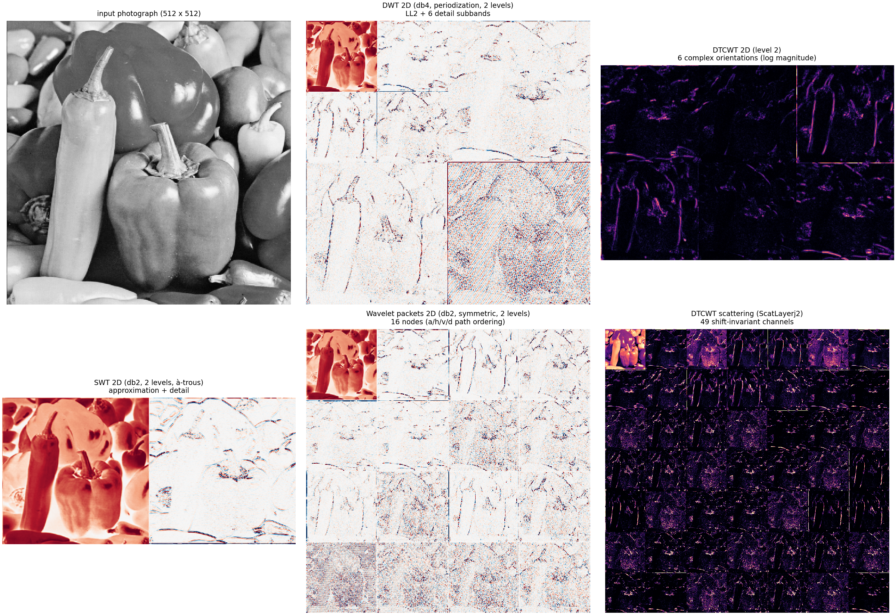
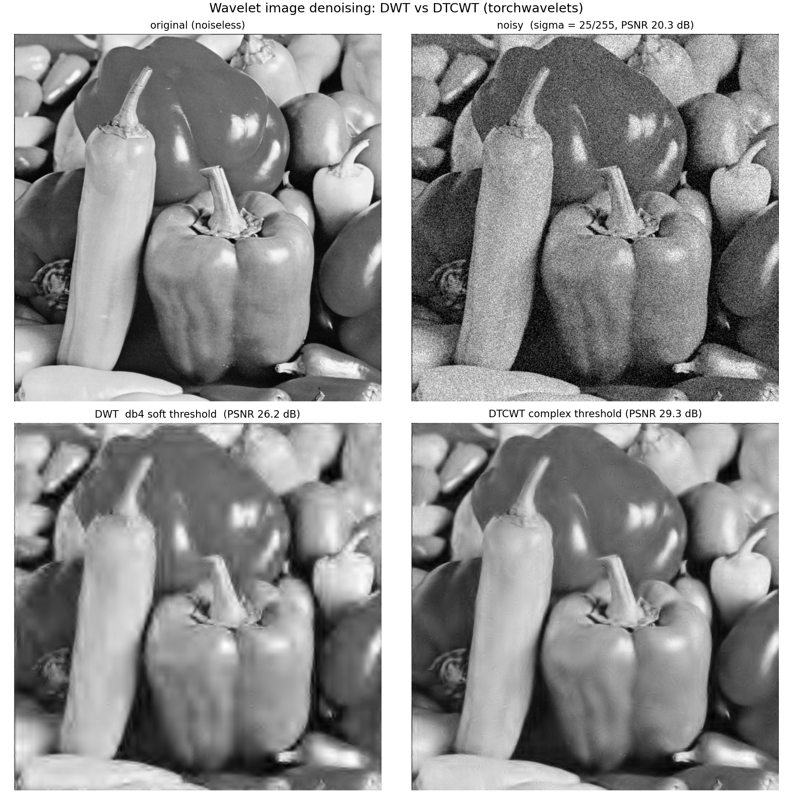
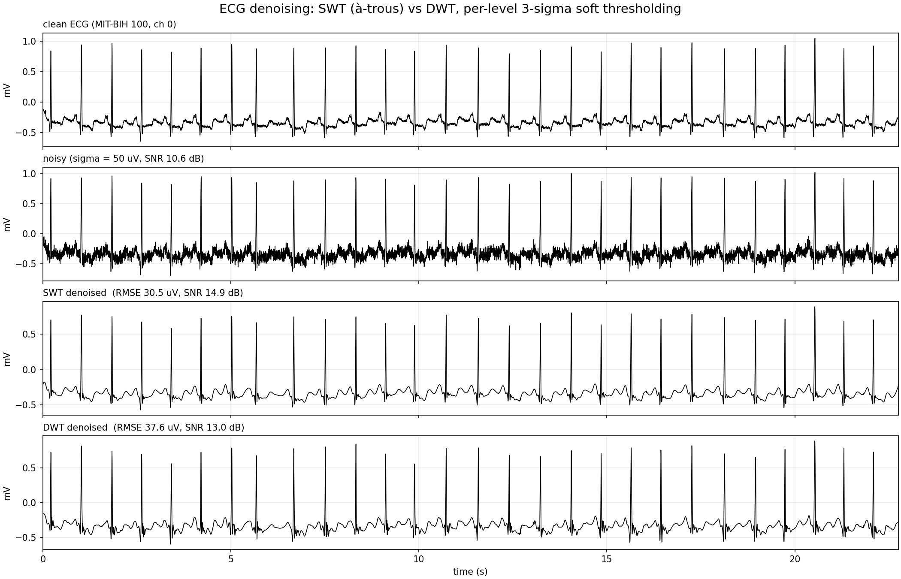
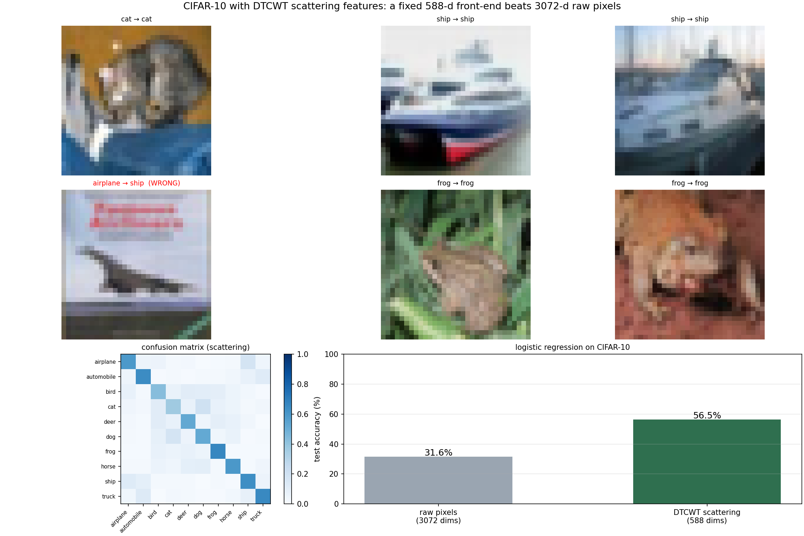
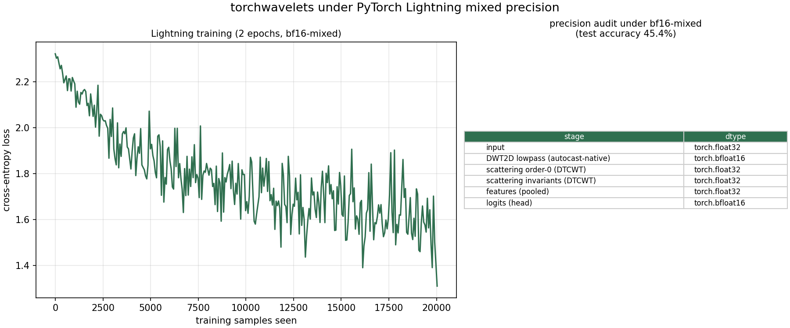

# Examples and applications

`torchwavelets` ships self-contained, reproducible examples. Each one
downloads its (real) data on first use into `~/data/torchwavelets`, renders a
figure into `docs/figures/`, and prints the measured numbers. Everything runs
on CPU with only PyTorch + numpy + matplotlib (plus scikit-learn and Pillow
for the classification and photo examples):

```bash
pip install -e ".[examples]"       # torch, numpy, pywt + example deps
python examples/plot_transform_gallery.py
python examples/application_denoising.py
python examples/application_ecg.py
python examples/application_cifar10.py
```

| script | application | data |
|---|---|---|
| `plot_transform_gallery.py` | visual tour of every transform | photograph (USC-SIPI) |
| `application_denoising.py` | image denoising, DWT vs DTCWT | photograph (USC-SIPI) |
| `application_ecg.py` | ECG denoising, SWT vs DWT | MIT-BIH record 100 (PhysioNet) |
| `application_cifar10.py` | image classification with scattering features | CIFAR-10 |

---

## 1. A tour of every transform

`python examples/plot_transform_gallery.py` applies the whole package to a
real 512x512 photograph (the classic *peppers* test image): the critically
sampled DWT, the six complex orientations of the DTCWT, the undecimated SWT,
the full binary wavelet-packet tree, and the 49 shift-invariant channels of a
two-scale DTCWT scattering layer.



What to look at:

* **DWT 2D** — three separable orientations (LH/HL/HH) per level; the energy
  concentrates along horizontal, vertical and diagonal edges.
* **DTCWT 2D** — six complex orientations at ±15°, ±45°, ±75°, giving
  *directional* selectivity and near shift invariance (no aliasing of the
  checkerboard kind).
* **SWT 2D** — the à-trous approximation and detail keep the full input
  resolution (no decimation), so fine features are never discarded.
* **Wavelet packets 2D** — 16 nodes of the quaternary tree
  (`a/h/v/d` path ordering, PyWavelets-compatible).
* **DTCWT scattering** — smoothed moduli of the bandpasses; the invariants
  are exactly shift-invariant at dyadic shifts.

---

## 2. Image denoising: DWT vs DTCWT

`python examples/application_denoising.py` corrupts the photograph with white
Gaussian noise (σ = 25/255) and restores it by **per-level soft
thresholding** of the wavelet coefficients — the same 3σ rule for both
transforms:

* **DWT** (db4, 4 levels, periodization): real soft threshold
  `sign(c) · max(|c| − λ, 0)` per subband.
* **DTCWT** (near_sym_a / qshift_a, 4 levels): *complex* (Kingsbury)
  shrinkage `W · max(1 − λ/|W|, 0)` on the six orientation bandpasses.



| method | PSNR |
|---|---|
| noisy (σ = 25/255) | 20.3 dB |
| DWT, db4 soft threshold | 26.2 dB |
| **DTCWT, complex threshold** | **29.3 dB (+3.1 dB)** |

Why the DTCWT wins: its 2× redundancy and near shift invariance make the
coefficients *consistent* — a feature's energy stays in a single orientation
across nearby scales, so the complex threshold keeps it while the equivalent
real-domain threshold spreads the attenuation across misaligned DWT
coefficients. (Implementation detail worth knowing: the DTCWT coefficient
noise floor is ≈3× lower than the DWT's, so per-level thresholds must be
estimated from the actual coefficient statistics — the example measures them
from a noise-only forward pass.)

---

## 3. ECG denoising: SWT vs DWT

`python examples/application_ecg.py` takes a real 360 Hz electrocardiogram
(MIT-BIH Arrhythmia record 100, channel 0, 8192 samples), adds 50 µV of white
noise, and compares two wavelet denoisers under the same per-level 3σ soft
thresholding:

* **DWT** (db4, 5 levels, symmetric) — critically sampled.
* **SWT** (db4, 5 levels, à-trous) — undecimated: every translation of the
  wavelet is kept at every scale.



| method | RMSE | SNR |
|---|---|---|
| noisy (σ = 50 µV) | — | 10.6 dB |
| DWT, soft threshold | 37.6 µV | 13.0 dB |
| **SWT, soft threshold** | **30.5 µV** | **14.9 dB (+1.9 dB)** |

The SWT is more faithful because thresholded undecimated coefficients still
correspond to *every* time instant — the denoised signal cannot develop the
shift-consistency artefacts of the critically sampled reconstruction, and the
QRS complexes survive with less distortion.

---

## 4. CIFAR-10 classification with scattering features

`python examples/application_cifar10.py` runs the classic Mallat recipe: a
**fixed, untrained** DTCWT scattering front-end extracts locally
shift-invariant features, and only a linear classifier is learned on top:

1. `DTCWTScattering(J=2, max_order=2)` on every 32x32 colour image →
   147 invariants (order-0 lowpass, first-order paths `(1,)`, `(2,)` and the
   second-order path `(1,2)`, 6/18 orientations per channel).
2. 2×2 average pooling of each invariant → 588 dimensions per image.
3. Multinomial logistic regression (standardised features, lbfgs, converged).

Baseline: the same classifier on the 3072 raw pixels.



| features | test accuracy |
|---|---|
| raw pixels (3072-d) | 31.6 % |
| **DTCWT scattering (588-d, untrained)** | **56.5 % (+24.9 points)** |

The front-end contributes no learned parameters: the gain comes from the
scattering transform itself — modulus nonlinearities that are stable to
deformations, and invariance that is built in rather than learned. This is
the same recipe behind early deep "scattering networks" and still a strong
baseline for small-data regimes.

## 5. Mixed-precision training with PyTorch Lightning

`python examples/application_lightning.py` trains a small CIFAR-10 classifier
with PyTorch Lightning: a **frozen** torchwavelets front-end (a critically
sampled `DWT2D` layer + a `DTCWTScattering` network, zero learned parameters)
feeds a learnable MLP head. The script picks `precision="16-mixed"` on CUDA
and `"bf16-mixed"` on CPU, and prints an **audit of the dtype of every stage**
produced *inside the Trainer's autocast context*:



| stage | dtype under `bf16-mixed` | why |
|---|---|---|
| input | float32 | data loader |
| DWT2D lowpass | **bfloat16** | autocast-native: follows the Trainer precision |
| DTCWT scattering | **float32** | documented exception: no complex bf16 kernels; never breaks AMP |
| pooled features | float32 | computed from the float32 scattering |
| head logits | **bfloat16** | linear layer runs in the autocast dtype |

This is the precision-management contract of the package:

* **DWT / SWT** are built from plain `conv2d`/`conv_transpose2d` ops — output
  dtype == autocast dtype (`bfloat16`/`float16`/`float32`), and `fp16`/`bf16`/
  `fp32`/`fp64` inputs pass through unchanged outside autocast.
* **DTCWT (1D/2D/3D), scattering layers and networks** compute in float32
  (half and bfloat16 inputs are promoted) and run in an autocast-disabled
  scope — `torch.complex` has no bf16 kernel, so this is the only way to be
  AMP-safe. The result is float32/complex64 regardless of the Trainer
  precision.
* Nothing requires `torch.set_default_dtype`; the module API resolves filters
  eagerly, so `torch.compile` and Lightning work together.

The companion test suite (`tests/test_lightning.py`) asserts exactly this for
`Trainer(precision="32-true"/"64-true"/"bf16-mixed")` on CPU and
`"16-mixed"` on CUDA, and checks gradients flow through both wavelet layers
inside a Lightning training step.

---

## Reproducibility

* Fixed seeds (`torch.manual_seed`, `numpy.random.default_rng`) — the numbers
  in this page are reproducible.
* Data is downloaded once and cached in `~/data/torchwavelets` (photograph,
  CIFAR-10, MIT-BIH ECG); run the scripts from the repository root.
* Reference results (CPU, this repository at commit `6bf6a0a`):

| example | reference result |
|---|---|
| denoising | DWT 26.2 dB → DTCWT 29.3 dB |
| ECG | DWT 13.0 dB → SWT 14.9 dB SNR |
| CIFAR-10 | raw 31.6 % → scattering 56.5 % |
| Lightning (bf16-mixed) | 45.4 % test accuracy; DWT→bf16, DTCWT→fp32 |
